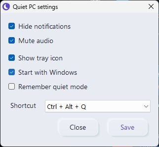
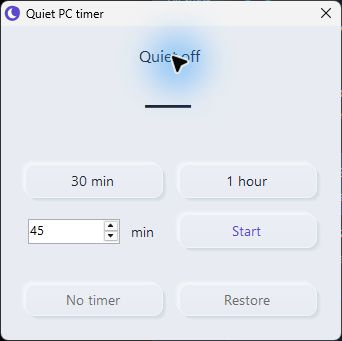

# Quiet PC

[](https://github.com/ashbmstu/quiet-pc/actions/workflows/ci.yml)
[](https://github.com/ashbmstu/quiet-pc/releases/latest)
[](LICENSE)


Windows tray app. Mutes playback audio and suppresses notifications. Click again to restore previous settings.

<p>
  
  
</p>

- Timers: 30 minutes, 1 hour, or 1–10,080 minutes.
- Manual unmute takes priority for the rest of the session.
- Optional startup, visible tray icon and keyboard shortcut.
- Local commands with JSON replies. No network access or administrator rights.

## Install

Windows x64, .NET Framework 4.x. Tested on Windows 11 24H2, build 26100.

[Download the latest release](https://github.com/ashbmstu/quiet-pc/releases/latest). Extract the ZIP and double-click **Install.cmd**. The build is unsigned.

From source:

```powershell
.\scripts\build.ps1
.\scripts\test.ps1
.\scripts\install.ps1
```

Installed files: `%LOCALAPPDATA%\Programs\QuietPC`. Preferences and recovery: `%LOCALAPPDATA%\QuietPC`.

## Controls

| Control | Action |
|---|---|
| Tray click / Ctrl+Alt+Q | Toggle quiet mode |
| Quiet for | Start a timer |
| Timer | View or replace the timer |
| No timer | Keep quiet mode on indefinitely |
| Restore | End quiet mode |
| Settings | Audio, notifications, startup, visibility and shortcut |
| Restore & exit | Restore settings and close |

Indigo: on. Crossed moon: off. Amber: error; open **Details**.

## Commands

```powershell
.\scripts\quietpc.ps1 status
.\scripts\quietpc.ps1 for -Minutes 30
.\scripts\quietpc.ps1 off
```

## Limits

- App-drawn alerts, ASIO and some exclusive-mode audio bypass Windows controls.
- Expiry during sleep or while closed is handled on resume or restart.
- Disconnected outputs restore when reconnected. Manual audio choices are preserved.
- New outputs may briefly play before detection.
- Notification control uses an internal Windows interface; updates may break compatibility.

## Uninstall

Run `scripts/uninstall.ps1`. Pending restoration blocks removal. Preferences and recovery files are retained.

## Documentation

[Usage](docs/user-guide.md) · [Commands](docs/commands.md) · [Assistants](docs/agents.md) · [Architecture](docs/architecture.md) · [Roadmap](docs/roadmap.md) · [Design](docs/branding.md) · [Contributing](CONTRIBUTING.md) · [Releases](docs/releasing.md)

[MIT licence](LICENSE)
